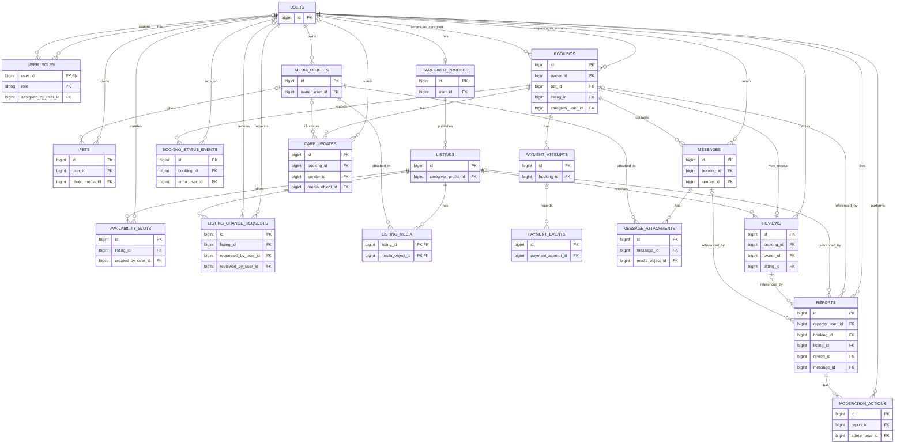

# PETTEL

Nền tảng tìm và đặt dịch vụ chăm sóc thú cưng tại Đà Nẵng. Stack đích: Laravel 13/PHP 8.3 cho JSON API, Next.js App Router trong `frontend/`, Sanctum stateful cookie/CSRF, MySQL 8.4, Redis 7 và Docker Compose. Breeze API cung cấp scaffold xác thực; Filament dành cho admin, Scramble cho OpenAPI, Pulse cho quan sát. Chi tiết stack và các ràng buộc nằm trong [Technology & Tools](<docs/08 — Architecture & Technical Design/10 — Technology & Tools — Responsibilities & Constraints.md>).

## Trạng thái hiện tại

Backend có xác thực Breeze/Sanctum, vai trò OWNER/CAREGIVER/ADMIN, các workflow nghiệp vụ P0, Filament cho quản trị, Scramble cho OpenAPI và Pulse cho quan sát. Docker có MySQL, Redis, worker và scheduler; môi trường test dùng MySQL riêng. Có tài khoản, pet và caregiver profile minh họa. Frontend Next.js trong `frontend/` đã kết nối các luồng tài khoản, tìm dịch vụ, thú cưng, đặt lịch, thanh toán sandbox, chat, chăm sóc và duyệt dịch vụ. Xem [hướng dẫn frontend](frontend/README.md) và [danh mục tích hợp](docs/frontend-backend-integration.md).

## Chạy dịch vụ nền

Yêu cầu Docker Desktop đang chạy Linux containers (hoặc Docker Engine trên Linux) và Docker Compose v2 trở lên. Runtime trong image là PHP 8.3, MySQL 8.4 và Redis 7. Các lệnh dưới đây chạy bằng PowerShell tại thư mục gốc repo; không cần dùng PHP/Composer trên máy host.

### 1. Tạo cấu hình local và APP_KEY

```powershell
if (!(Test-Path .env)) {
    Copy-Item backend/.env.example .env
}
docker compose build
docker compose run --rm --no-deps backend php artisan key:generate --show
```

Sao chép chuỗi `base64:...` được tạo vào `APP_KEY=` trong **`.env` ở gốc repo**, rồi lưu file. Chỉ tạo key khi thiết lập lần đầu; giữ nguyên key khi khởi động lại. Không commit `.env`.

Compose đọc `.env` gốc để thay biến trong `compose.yaml`, sau đó truyền các biến đã khai báo trong `environment` cho Laravel. File `.env` gốc không được mount vào container; `key:generate --show` giúp lấy key để lưu đúng vị trí. Các tên host `db` và `redis` dành cho kết nối bên trong Docker.

### 2. Khởi động, migrate và seed

```powershell
docker compose up -d db redis backend frontend web
docker compose exec -T backend php artisan migrate --force
docker compose exec -T backend php artisan db:seed --force
docker compose up -d worker scheduler
```

Migrate trước khi bật worker/scheduler để các tiến trình nền không sử dụng bảng chưa được tạo. Seeder chỉ cho chạy khi `APP_ENV=local` hoặc `testing`.

### 3. Kiểm tra dịch vụ

```powershell
docker compose ps
Invoke-RestMethod http://localhost:8080/
Invoke-WebRequest -Uri http://localhost:8080/up -UseBasicParsing | Select-Object StatusCode
docker compose exec -T redis redis-cli ping
```

Kết quả mong đợi: `/` trên cổng 8080 trả JSON trạng thái API, `/up` trả HTTP 200, Redis trả `PONG`; `web`, `frontend`, `db` và `redis` có trạng thái `healthy`. Worker/scheduler phải ở trạng thái chạy. Next.js được build sẵn trong service `web` tại http://localhost:3000; service `frontend` là Nginx/API Laravel ở cổng 8080.

Sau khi thiết lập lần đầu, chạy `docker compose up -d` hoặc Start các container của project PETTEL trong Docker Desktop để mở toàn bộ ứng dụng. Không cần chạy `npm run dev` riêng. Các service dùng `restart: unless-stopped`, nên Docker tự khởi động lại container khi engine khởi động nếu container chưa bị Stop thủ công.

Sau khi sửa frontend, chạy `docker compose up -d --build web` để cập nhật bản chạy trong Docker. Các biến `NEXT_PUBLIC_*` được đưa vào bundle lúc build; Compose lấy API URL và địa chỉ socket từ `.env` gốc, public Reverb key từ `REVERB_APP_KEY`. Không đưa Reverb secret vào frontend. Dừng Next.js chạy bằng `npm run dev` trên Windows trước khi bật `web` để tránh trùng cổng 3000.

Nếu thay `APP_PORT`, cập nhật đồng bộ `APP_URL`, `FRONTEND_URL`, `SANCTUM_STATEFUL_DOMAINS` trong `.env` và dùng cổng mới trong các lệnh kiểm tra.

## Tài khoản và dữ liệu mẫu

| Email | Vai trò | Mật khẩu khi tạo mới |
| --- | --- | --- |
| `owner@example.test` | OWNER | `DemoOnly123!` |
| `caregiver@example.test` | OWNER, CAREGIVER | `DemoOnly123!` |
| `admin@example.test` | ADMIN | `DemoOnly123!` |

Seed còn tạo pet `Demo Mochi`, `Demo Mèo Nấm`, `Demo Corgi Bắp` thuộc owner; 52 tài khoản sitter `sitter-001@example.test` đến `sitter-052@example.test`; 52 hồ sơ và listing đang hoạt động cùng lịch nhận đặt trong 6 tháng. Ảnh hồ sơ lấy từ `Pet sister/` của giao diện cũ, lưu thành media của listing và có thumbnail WebP. Dữ liệu điểm tin cậy, tiện ích, đánh giá hiển thị đều được đánh dấu là demo; seed không tạo booking hoặc đánh giá giao dịch.

Mật khẩu khởi tạo cho tài khoản sitter và tài khoản demo hiện có là `DemoOnly123!`. Tài khoản owner có thể đăng nhập để thử bộ lọc theo hồ sơ thú cưng; tài khoản sitter để thử các chức năng caregiver. Có thể chạy lại `db:seed`: seeder giữ nguyên mật khẩu tài khoản đã tồn tại, cập nhật dữ liệu catalog và không nhân bản listing/media/lịch demo. Thông tin đăng nhập chỉ dành cho local/test, không dùng cho môi trường public.

Khi cập nhật code hoặc fixture seed, áp dụng migration và nạp dữ liệu bằng:

```powershell
docker compose exec -T backend php artisan migrate --force
docker compose exec -T backend php artisan db:seed --force
docker compose up -d --build backend web
```

## Worker và scheduler

Worker xử lý queue Redis với timeout 60 giây, nhỏ hơn `REDIS_QUEUE_RETRY_AFTER=90`. Khi `APP_ENV=local`, scheduler gửi job `InfrastructureHeartbeat` mỗi phút; worker ghi timestamp vào Redis cache với thời hạn 180 giây.

```powershell
docker compose exec -T backend php artisan schedule:list
docker compose logs --tail=30 worker scheduler
docker compose exec -T backend php artisan tinker --execute="dump(cache()->get('infra:heartbeat'));"
docker compose exec -T backend php artisan queue:failed
```

Sau khi khởi động, chờ hơn một phút rồi đọc heartbeat. Đọc lại sau một phút: timestamp phải tăng, đồng thời log worker phải có job `DONE`. Giá trị `null` sau thời gian chờ hoặc timestamp không tăng cần kiểm tra log, Redis và trạng thái worker/scheduler. Timestamp mặc định được ghi theo UTC.

## Cảnh báo lỗi qua Slack

Tạo Slack Incoming Webhook cho kênh `#pettel-alerts`, rồi lưu URL trong `.env` gốc (không commit URL):

```env
LOG_STACK=single,slack
LOG_SLACK_WEBHOOK_URL=https://hooks.slack.com/services/REPLACE_WITH_YOUR_WEBHOOK
LOG_SLACK_LEVEL=error
```

Compose chuyển các biến này vào Laravel. Sau khi cập nhật `.env`, tạo lại các tiến trình Laravel rồi gửi thử một log lỗi:

```powershell
docker compose up -d --force-recreate backend worker scheduler
docker compose exec -T backend php artisan tinker --execute='Log::error("PETTEL Slack integration test");'
```

Thông báo thử nghiệm cần xuất hiện trong `#pettel-alerts`. Webhook URL là thông tin bí mật; nếu bị lộ, thu hồi URL đó trong Slack và tạo URL mới.

## Kiểm tra định dạng, migration, seed và test

Chạy tại gốc repo:

```powershell
docker compose -p pettel-test -f compose.test.yaml run --build --rm test
```

Runner dừng ngay khi một bước lỗi và thực hiện lần lượt:

1. Tạo `.env` rỗng trong container test và xóa config cache.
2. Pint kiểm tra định dạng và PHPStan phân tích tĩnh (`composer ci:check`).
3. `migrate:fresh --seed` trên database `pettel_test`.
4. Seed lần hai để kiểm tra khả năng chạy lặp.
5. Chạy PHPUnit; `DemoSeederTest` kiểm tra số bản ghi, vai trò và bảo toàn mật khẩu sau khi seed lại.

Luôn dùng file Compose và project test riêng như lệnh trên. `db-test` dùng MySQL 8.4, database/tài khoản `pettel_test` và dữ liệu tạm trên `tmpfs`; không gắn volume demo hay mở cổng database ra host. Cache/session/mail dùng `array`, queue dùng `sync`. PHPUnit ép cấu hình test; `Tests\TestCase` kiểm tra môi trường, driver, database và tài khoản trước khi chạy các trait migration. Không chạy `migrate:fresh` trên service `backend` của demo.

Dọn môi trường test sau khi kiểm tra:

```powershell
docker compose -p pettel-test -f compose.test.yaml down -v --remove-orphans
```

Lệnh dọn này chỉ dành cho project `pettel-test`. Database demo vẫn thuộc project `pettel`. Để xác minh dữ liệu demo không bị tác động, đối chiếu tài khoản/pet demo trước và sau test; không chỉ dựa vào kết quả test xanh.

Workflow `.github/workflows/tests.yml` chạy cùng lệnh Docker trên pull request và khi push vào `main` hoặc `be-ha01`, in log database nếu lỗi và dọn môi trường test khi kết thúc. Sau khi commit/push, kiểm tra kết quả trong GitHub Actions trước khi bàn giao review.

## Cập nhật code và xử lý lỗi

Mã nguồn được COPY vào image, không có bind mount để tự nhận thay đổi. Sau khi sửa code:

```powershell
docker compose up -d --build
docker compose exec -T backend php artisan migrate --force
docker compose restart frontend
```

Nếu thay đổi liên quan seed, chạy thêm `docker compose exec -T backend php artisan db:seed --force` khi cần cập nhật dữ liệu demo. Worker và scheduler cũng cần được tạo lại từ image mới như lệnh `up --build` ở trên.

Nếu `/up` trả 502 sau khi backend được tạo lại, Nginx có thể còn giữ địa chỉ backend cũ. Kiểm tra và khởi động lại Nginx:

```powershell
docker compose logs --tail=50 frontend backend
docker compose restart frontend
Invoke-WebRequest -Uri http://localhost:8080/up -UseBasicParsing | Select-Object StatusCode
docker compose ps
```

Đợi healthcheck cập nhật và xác nhận `frontend` trở lại `healthy`. Nếu vẫn lỗi, kiểm tra log PHP-FPM và kết nối upstream; không coi việc container đang chạy là bằng chứng API hoạt động.

## Dịch vụ Compose

| Service | Vai trò |
| --- | --- |
| `frontend` | Nginx, cổng HTTP duy nhất mở ra host |
| `backend` | Laravel PHP-FPM |
| `worker` | Redis queue |
| `scheduler` | Laravel scheduler |
| `db` | MySQL 8.4, named volume |
| `redis` | Cache và queue, named volume |

MySQL không mở cổng ra host. `.env` chỉ dành cho local; không dùng secret mặc định cho demo public. `docker compose down` giữ dữ liệu; `docker compose down -v` xóa volume MySQL, Redis và storage.

## Cấu trúc

```text
backend/                    # Laravel JSON API
├── app/                    # Domain, HTTP, Models, Providers
├── bootstrap/              # Laravel bootstrap
├── config/                 # Framework configuration
├── database/               # Migrations, factories, seeders
├── public/                 # Laravel front controller và public assets
├── routes/                 # Web/API routes
├── tests/                  # Backend tests được bổ sung cùng tính năng
├── composer.json
└── Dockerfile
frontend/                   # Next.js App Router + React UI
docs/                       # Yêu cầu, thiết kế và kế hoạch PETTEL
compose.yaml                # Docker Compose
```

`backend/public/index.php` là entry point của Laravel và vẫn cần cho API. Giao diện Next.js/React thuộc `frontend/`; không đặt component giao diện này trong `backend/resources`. Filament vẫn dùng Blade/Livewire nội bộ cho trang quản trị Laravel.

## ERD cơ sở dữ liệu

Sơ đồ dưới đây tóm tắt các bảng nghiệp vụ chính và quan hệ khóa ngoại trong migrations. Các bảng hạ tầng của Laravel, Pulse, Telescope và các bảng nhật ký phụ trợ được lược bớt để sơ đồ dễ đọc.



## Tài liệu

- [Mục lục](<docs/00 — PETTEL Documentation Index.md>)
- [Product](<docs/01 - Product Document/>)
- [Domain](<docs/02 — Domain Documentation/>)
- [Modules](<docs/03 — Modules Documentation/>)
- [Workflows](<docs/04 — Workflows/>)
- [Implementation Plan](<docs/05 — Implementation Plan/>)
- [Non-functional Requirements](<docs/06 — Non-functional Requirements/>)
- [Architecture & Technical Design](<docs/08 — Architecture & Technical Design/>)
- [Backlog 4 tuần](<docs/PETTEL — Task 4 tuần (A, B, C)/Chia task.md>)
