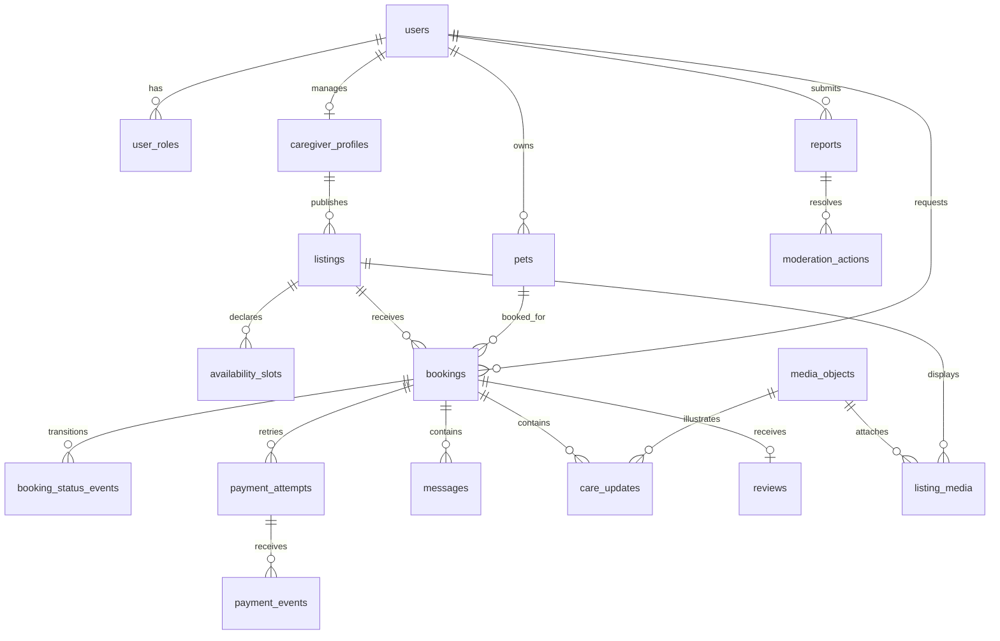

# Database Design — PETTEL P0

**Trạng thái:** thiết kế đích để nhóm review và triển khai, **chưa phải schema đã chạy**. Cập nhật 27/10/2026. Phạm vi: bản mẫu dịch vụ chăm sóc thú cưng tại Đà Nẵng, MySQL 8.4, Laravel 13, một pet và một listing cho mỗi booking, công suất mặc định một booking đồng thời trên một listing, payment **sandbox**.

## 1. Cách đọc và nguồn quyết định

Tài liệu này là bản thiết kế database tổng thể, chi tiết hóa [Data Model, Indexes & Data Integrity](<03 — Data Model, Indexes & Data Integrity.md>). Các quy tắc nghiệp vụ lấy từ [Domain Model](<../02 — Domain Documentation/03 — Domain Model.md>), [Business Rules](<../02 — Domain Documentation/02 — Business Rules.md>), [State Lifecycles](<../02 — Domain Documentation/04 — State Lifecycles — Listing, Order, Payment.md>) và [Module Map](<../03 — Modules Documentation/00 — Module Map & Dependencies.md>). Những quyết định về quyền, file và payment đối chiếu [Authentication Design](<05 — Authentication & Authorization Design.md>), [File Storage Design](<08 — File Storage Design.md>) và [Payment Sandbox Integration](<07 — Payment Sandbox Integration.md>). [Performance & Capacity](<../06 — Non-functional Requirements/02 — Performance & Capacity.md>) và [Reliability & Recovery](<../06 — Non-functional Requirements/03 — Reliability & Recovery.md>) là mục tiêu đề xuất, chưa được đo.

**Hiện trạng repository:** chỉ có migration Laravel nền cho `users`, `password_reset_tokens`, `sessions`, `cache`, `cache_locks`, `jobs`, `job_batches`, `failed_jobs`; chưa có migration nghiệp vụ. `users` thực tế có `name`, `email`, `email_verified_at`, `password`, `remember_token`, timestamps. Không đổi `password` thành `password_hash`: tên trong Data Model cũ chỉ diễn đạt ý nghĩa. `sessions.user_id` hiện chỉ có index, chưa có FK. Redis là cache/queue theo kiến trúc đích; các bảng cache/job nền vẫn là phần hạ tầng Laravel và không phải nguồn dữ liệu nghiệp vụ. Migration hiện hành và code chưa chứng minh bất kỳ quy tắc nào dưới đây đã được triển khai.

**Mức chắc chắn:** tài liệu nguồn trước đây có nhiều đề xuất và câu “cần chốt”; §12 và P0 Decision Contract ngày 27/10/2026 chốt các lựa chọn thiết kế cho bản mẫu. Đây là quyết định tài liệu, chưa phải schema/code đã chạy hoặc phê duyệt chính sách tiền thật/pháp lý.

## 2. Nguyên tắc dữ liệu chung

| Quy ước | Thiết kế |
| --- | --- |
| Primary key | `BIGINT UNSIGNED` auto increment (`$table->id()`), API serialize ID thành chuỗi. Dùng cùng kiểu cho mọi FK. |
| Thời gian | Timestamps DB lưu UTC; API ISO 8601, giao diện hiển thị `Asia/Ho_Chi_Minh`. Khoảng lịch `[start_at,end_at)`; `start_at < end_at`. `DATETIME(6)` cho thời gian nghiệp vụ và event nếu cần thứ tự chính xác; `created_at, id` là thứ tự ổn định. |
| Tiền | `BIGINT UNSIGNED` VND nguyên, không dùng float; `CHECK(amount_vnd >= 0)` nếu cột signed, và giới hạn nghiệp vụ trước ghi. Không có tiền hoặc thông tin thẻ thật. |
| Chuỗi trạng thái | `VARCHAR` + `CHECK`/validation tập giá trị trong service, thay vì MySQL `ENUM` để migration trạng thái dễ kiểm soát. DB check hỗ trợ trên MySQL 8.4; test migration trên DB thật. |
| Charset | `utf8mb4`, collation nhất quán. Email chuẩn hóa chữ thường trước ghi; `UNIQUE(email)` và quy tắc so sánh theo collation phải được test. |
| Xóa | `pets`, `caregiver_profiles`, `listings` xóa mềm; booking, payment, review, report, audit không cascade xóa cứng. FK `RESTRICT/NO ACTION` với lịch sử. Chính sách giữ/xóa vĩnh viễn xem §12. |
| Snapshot | Booking giữ giá và chính sách bất biến về nghiệp vụ; pet notes/PII trong snapshot được redact khi hết retention, có audit và `privacy_redacted_at`. Chỉ chứa trường đã xác định, không dump toàn bộ model hay secret. JSON snapshot có `schema_version`; không dùng JSON làm nguồn query/search. |
| Cập nhật | `created_at`, `updated_at` cho bảng mutable; event/audit append only. Không sửa trạng thái trực tiếp từ controller, Filament hay job; gọi service giao dịch. |

Không dùng Redis làm bằng chứng còn chỗ, quyền hoặc trạng thái payment. Mọi idempotency và chống trùng cuối cùng do unique constraint + transaction MySQL bảo vệ.

## 3. Sơ đồ quan hệ P0

`reports` trỏ tới một trong bốn loại đích bằng FK riêng (xem §8), vì một cặp `target_type,target_id` đa hình không có FK thật. `audit_logs` tham chiếu actor nhưng lưu resource type/ID để ghi cả sự kiện hạ tầng; khi actor bị vô hiệu, lịch sử vẫn tồn tại.

## 4. Danh mục bảng và cột cốt lõi

Ký hiệu `!` = NOT NULL, `?` = nullable, `UQ` = unique. Ngoài các cột liệt kê, bảng mutable có timestamps; các bảng lịch sử có `created_at` và không cho cập nhật nội dung.

### M01 — Identity

| Bảng | Cột cốt lõi | Khóa / quy tắc |
| --- | --- | --- |
| `users` (đã có, mở rộng) | `id`, `name!`, `email!`, `password!`, `email_verified_at?`, `remember_token?`, `status!` (`ACTIVE`, `SUSPENDED`, `DELETION_PENDING`, `DEACTIVATED`), `deletion_requested_at?`, timestamps | `UQ(email)` hiện có. `status` mới mặc định `ACTIVE`; `DELETION_PENDING` chỉ cho thao tác booking/report đang mở; sau khi đóng, ẩn danh và `DEACTIVATED` trong tối đa 30 ngày. Admin provisioning riêng. Không coi `email_verified_at` là email đã xác minh khi luồng verification chưa bật. |
| `user_roles` | `user_id!`, `role!` (`OWNER`, `CAREGIVER`, `ADMIN`), `assigned_at!`, `assigned_by_user_id?` | PK `(user_id,role)`; FK user và assigner. Đăng ký thường gán OWNER phía server; user có thể đồng thời OWNER/CAREGIVER; ADMIN chỉ cấp ngoài luồng tự đăng ký. User tự bật CAREGIVER với audit; chỉ listing cần admin duyệt. |

Giữ nguyên bảng Laravel `password_reset_tokens` và `sessions`; không tạo token SPA riêng. Nếu dùng Sanctum stateful cookie, `personal_access_tokens` chỉ xuất hiện nếu package/migration yêu cầu cho client bên ngoài, không dùng cho Vue P0.

### M02 — Pet Profiles

| Bảng | Cột cốt lõi | Khóa / quy tắc |
| --- | --- | --- |
| `pets` | `id`, `user_id!`, `name!`, `species!`, `birth_date?`, `age_note?`, `sex?`, `size?`, `diet_notes?`, `vaccination_note?`, `temperament?`, `special_needs?`, `status!`, `photo_media_id?`, `deleted_at?` | FK user `RESTRICT`; FK photo `SET NULL` chỉ nếu file không thuộc lịch sử; kiểm tra `photo_media_id` thuộc user bằng service. `species/size` dùng danh mục P0 ở §12/P0 Decision Contract, thống nhất với điều kiện listing. `birth_date` hoặc `age_note` có thể thiếu, không suy ra độ tuổi chính xác từ ghi chú. |

`vaccination_note` là tự khai, không phải chứng nhận y tế. Pet không có trong search công khai. Booking dùng snapshot nên sửa/xóa mềm pet không đổi hướng dẫn đã gửi.

### M03/M04 — Caregiver, Listing, Availability, Discovery

| Bảng | Cột cốt lõi | Khóa / quy tắc |
| --- | --- | --- |
| `caregiver_profiles` | `id`, `user_id!`, `type!` (`INDIVIDUAL`,`FACILITY`), `display_name!`, `bio?`, `area_code!`, `status!`, `deleted_at?` | `UQ(user_id)`. Một cơ sở P0 chỉ có một user quản lý. Không lưu địa chỉ chi tiết vào bản công khai nếu không cần. |
| `listings` | `id`, `caregiver_profile_id!`, `title!`, `description!`, `service_type!`, `area_code!`, `price_vnd!`, `price_unit!`, `capacity!` mặc định 1, `acceptance_rules_json!`, `cancellation_policy_text?`, `status!`, `published_at?`, `version!`, `deleted_at?` | FK profile `RESTRICT`; `price_vnd > 0`, `capacity = 1` ở P0; P0 giới hạn một booking đang khóa lịch trên mỗi listing, chưa giới hạn tổng booking của cùng caregiver qua nhiều listing. Status `DRAFT`, `PENDING_REVIEW`, `ACTIVE`, `SUSPENDED`, `ARCHIVED`. `DAYCARE` dùng `HOUR`, `BOARDING` dùng `NIGHT`; công thức và giới hạn ở §12/P0 Decision Contract. Không dùng `availability` boolean. |
| `availability_slots` | `id`, `listing_id!`, `start_at!`, `end_at!`, `created_by_user_id!`, `deleted_at?` | FK listing/creator; `start_at < end_at`; các slot khai báo phải được chuẩn hóa không chồng nhau trên cùng listing trong service, dưới lock listing. Theo quyết định P0, slot là khoảng mở và booking phải nằm trọn trong một slot liên tục; listing chưa có slot thì không nhận booking. |
| `listing_media` | `listing_id!`, `media_object_id!`, `sort_order!` | PK `(listing_id,media_object_id)`, `UQ(listing_id,sort_order)`; ảnh chỉ công khai khi listing ACTIVE và được duyệt. |

`acceptance_rules_json` chứa danh sách loài/kích cỡ/tuổi và hỗ trợ nhu cầu đặc biệt ở dạng có schema/version; chỉ lưu các điều kiện thực sự dùng trong Smart Match. Nếu lọc loài bằng SQL thường xuyên, tách `listing_accepted_species(listing_id,species_code)` với PK kép và index đảo `(species_code,listing_id)` trước khi thực hiện search; không dùng `LIKE` trên JSON. `area_code` dùng năm vùng nội bộ Đà Nẵng trong P0 Decision Contract; user chọn vùng, không suy ra địa giới hành chính từ mã.

**Duyệt thay đổi listing — quyết định P0:** sửa giá, loại dịch vụ hoặc điều kiện nhận pet của listing `ACTIVE` tạo `listing_change_requests`; bản đã duyệt tiếp tục công khai và nhận booking trong lúc chờ. Chỉ áp dụng nội dung mới sau khi admin duyệt trong transaction khóa listing + request, rồi tăng `version`; booking cũ giữ snapshot. Tối đa một request `PENDING`/listing. Caregiver được rút request đang chờ; nếu không thể thực hiện theo bản cũ, phải tạm ngưng listing. Các trường cần duyệt lại được quản lý qua allowlist trong service; trường trình bày không trọng yếu có thể cập nhật trực tiếp theo contract.

### M05 — Booking

| Bảng | Cột cốt lõi | Khóa / quy tắc |
| --- | --- | --- |
| `bookings` | `id`, `owner_id!`, `pet_id!`, `listing_id!`, `caregiver_user_id!`, `start_at!`, `end_at!`, `status!`, `price_snapshot_vnd!`, `pet_snapshot_json!`, `listing_snapshot_json!`, `policy_snapshot_json!`, `instructions_snapshot?`, `privacy_redacted_at?`, `payment_due_at?`, `current_payment_attempt_id?`, `request_idempotency_key!`, `request_payload_hash!`, `version!`, timestamps | FK owner/pet/listing/caregiver `RESTRICT`; FK current attempt thêm sau khi tạo `payment_attempts`; `UQ(owner_id,request_idempotency_key)`; `start_at < end_at`. Service xác nhận pet thuộc owner và caregiver khớp listing. |
| `booking_status_events` | `id`, `booking_id!`, `from_status?`, `to_status!`, `actor_user_id?`, `source!` (`USER`,`SYSTEM`,`SANDBOX`,`ADMIN`), `reason_code?`, `reason_text?`, `created_at!` | FK booking `RESTRICT`, actor `SET NULL` chỉ khi chính sách xóa user cho phép. Append only; ghi cùng transaction với trạng thái. |

`REQUESTED` không khóa lịch. Các trạng thái khóa lịch: `AWAITING_PAYMENT`, `CONFIRMED`, `IN_PROGRESS`, `AWAITING_CONFIRMATION`. `CANCELLED` thả lịch. **Quyết định P0:** `payment_due_at` được set bằng thời điểm accept + 15 phút; retry không gia hạn. Callback authorize sau hạn bị từ chối kể cả job hết hạn chưa chạy. Snapshot giá tạo tại REQUESTED được giữ nguyên nếu listing vẫn `ACTIVE` và các điều kiện nhận pet/dịch vụ trong snapshot không đổi; nếu điều kiện trọng yếu đổi hoặc listing ngừng `ACTIVE`, caregiver phải yêu cầu owner tạo booking mới. Booking `REQUESTED` hết hạn sau 24 giờ hoặc tại `start_at`, tùy mốc nào trước; job chuyển `CANCELLED` với `REQUEST_EXPIRED`. Caregiver phải accept trước mốc này.

### M06 — Payment Sandbox

| Bảng | Cột cốt lõi | Khóa / quy tắc |
| --- | --- | --- |
| `payment_attempts` | `id`, `booking_id!`, `attempt_no!`, `amount_vnd!`, `status!` (`PENDING`,`FAILED`,`AUTHORIZED`,`VOIDED`,`REFUNDED`,`RELEASED`), `provider_ref?`, `idempotency_key!`, `request_payload_hash!`, `authorized_at?`, `released_at?`, timestamps | FK booking `RESTRICT`; `UQ(booking_id,attempt_no)`, `UQ(booking_id,idempotency_key)`, `UQ(provider_ref)` (MySQL cho phép nhiều NULL). Amount = booking snapshot. Một current attempt do booking trỏ tới. |
| `payment_events` | `id`, `payment_attempt_id?`, `provider!`, `external_event_id!`, `event_type!`, `payload_hash!`, `processing_status!`, `rejection_code?`, `received_at!`, `processed_at?` | `UQ(provider,external_event_id)`; FK attempt `RESTRICT` nếu đã xác định được. Không lưu raw callback chứa secret/PII. Event không hợp lệ được ghi ở audit bảo mật giới hạn; không tạo payment state transition. |

`current_payment_attempt_id` tạo vòng FK nên migration tạo `bookings` trước, `payment_attempts` sau rồi thêm FK sau cùng; service kiểm tra attempt thuộc đúng booking. Retry chỉ khi current attempt `FAILED`, booking còn `AWAITING_PAYMENT` và chưa quá hạn. Callback hợp lệ chỉ được chuyển current attempt. `NOT_STARTED` là trạng thái suy ra khi chưa có attempt, không cần row. At most one `RELEASED`/booking phải được bảo vệ trong transaction khóa booking + current attempt; nếu cần bất biến ở DB độc lập ứng dụng, thêm generated column `released_booking_id = IF(status='RELEASED', booking_id, NULL)` với unique index, thử nghiệm trên MySQL 8.4 trước migration. Không hứa rằng một unique key thường `(booking_id,status)` làm được việc này vì nó cũng chặn nhiều `FAILED`.

### M07 — Messaging, Care Updates, Media

| Bảng | Cột cốt lõi | Khóa / quy tắc |
| --- | --- | --- |
| `messages` | `id`, `booking_id!`, `sender_id!`, `body!`, `visibility!` (`VISIBLE`,`HIDDEN`), `created_at!` | FK booking/sender `RESTRICT`; hai bên đọc khi có quyền; ghi từ `REQUESTED` đến `AWAITING_CONFIRMATION`, terminal state chỉ đọc. Admin đọc khi có lý do/audit. |
| `care_updates` | `id`, `booking_id!`, `sender_id!`, `body?`, `media_object_id?`, `visibility!`, `created_at!` | FK booking/sender/media `RESTRICT`; yêu cầu body hoặc media; chỉ tạo sau khi booking vào `IN_PROGRESS`, đóng quyền tạo mới khi rời `IN_PROGRESS`. Một ảnh/update P0; mở rộng bảng nối khi cần nhiều ảnh. |
| `media_objects` | `id`, `owner_user_id!`, `object_key!`, `mime_type!`, `byte_size!`, `sha256!`, `visibility!` (`PRIVATE`,`PUBLIC_ELIGIBLE`), `state!` (`READY`,`PENDING_DELETE`), timestamps | `UQ(object_key)`; FK owner `RESTRICT`; `byte_size > 0`; MIME/size kiểm tra trước lưu. DB chỉ giữ key, không giữ public URL lâu dài hay đường dẫn máy. |

File thực nằm private storage. `listing_media` chỉ là quan hệ ảnh listing; `pets.photo_media_id` và `care_updates.media_object_id` vẫn private. Xóa file vật lý theo mốc retention P0 ở §12, sau khi kiểm tra mọi tham chiếu và report mở. Không cascade từ booking đến tin nhắn/ảnh.

### M08 — Reviews và tín hiệu tin cậy

| Bảng | Cột cốt lõi | Khóa / quy tắc |
| --- | --- | --- |
| `reviews` | `id`, `booking_id!`, `owner_id!`, `listing_id!`, `rating!`, `body?`, `status!` (`VISIBLE`,`HIDDEN`), `is_demo!` mặc định false, timestamps | `UQ(booking_id)`, FK booking/owner/listing `RESTRICT`, `CHECK(rating BETWEEN 1 AND 5)`. Service chỉ cho owner của booking `COMPLETED`. `owner_id/listing_id` là bản sao phục vụ truy vấn, phải khớp booking. |

Chỉ review từ booking hoàn tất **thật trong hệ thống** và `VISIBLE` mới tính rating công khai. `is_demo` dùng để gắn nhãn minh họa; không gán “verified caregiver” từ review, rating hoặc seed. Không tạo bảng verification/badge P0; role caregiver tự kích hoạt, chỉ listing cần admin duyệt.

### M09 — Report, Moderation, Audit

| Bảng | Cột cốt lõi | Khóa / quy tắc |
| --- | --- | --- |
| `reports` | `id`, `reporter_user_id!`, `listing_id?`, `review_id?`, `message_id?`, `booking_id?`, `reason_code!`, `description?`, `status!` (`OPEN`,`IN_REVIEW`,`RESOLVED`,`DISMISSED`), `resolved_at?`, timestamps | FK từng target `RESTRICT`; `CHECK` đúng **một** trong bốn target ID khác NULL. Service kiểm tra reporter được xem target; không dùng polymorphic ID thiếu FK. |
| `moderation_actions` | `id`, `report_id!`, `admin_user_id!`, `action!`, `target_type!`, `target_id!`, `reason!`, `created_at!` | FK report/admin `RESTRICT`; append only. Target type/ID ở đây là dấu vết của hành động, đối chiếu report và dữ liệu đích trong service. |
| `audit_logs` | `id`, `actor_user_id?`, `action!`, `resource_type!`, `resource_id!`, `reason?`, `request_id?`, `metadata_json?`, `created_at!` | Append only, metadata allowlist không chứa password/token/chat/pet notes. Ghi admin đọc dữ liệu riêng, cấp role, can thiệp booking, xử lý listing/report và thao tác sandbox nhạy cảm. |

Không lưu bản sao nội dung riêng tư trong report/audit nếu không cần. Khi target bị xóa mềm, FK và record còn để điều tra. Lịch sử `moderation_actions` không thay thế event của booking/payment; admin action thay status vẫn phải gọi service nghiệp vụ và ghi event tương ứng.

## 5. Ràng buộc xuyên bảng và transaction bắt buộc

| Bất biến | Cách bảo vệ |
| --- | --- |
| Pet thuộc owner của booking | Service đọc pet trong transaction khi tạo booking; policy kiểm tra user. FK đơn lẻ không chứng minh quan hệ này. Có thể thêm composite FK `(pet_id,owner_id)` sau khi có unique `(id,user_id)` nếu nhóm muốn DB enforce. |
| Caregiver của booking khớp listing | Lấy từ `listings → caregiver_profiles → users`, không tin client. Snapshot `caregiver_user_id` để quyền lịch sử ổn định nếu profile thay đổi. |
| Booking chỉ từ listing ACTIVE | Kiểm tra khi REQUESTED và khi accept; lock listing khi accept. Không thể dùng CHECK cho trạng thái bảng khác. |
| Booking nằm trong slot khả dụng | Dùng interval coverage theo lịch đã khai báo, không chỉ “có slot overlap”; kiểm tra lại dưới cùng lock listing. Không khai báo slot thì không nhận booking (§12). |
| Một listing không có hai booking khóa lịch giao nhau | MySQL không có exclusion constraint theo khoảng. Khi accept và mọi thao tác sửa lịch, `SELECT listings.id ... FOR UPDATE`; sau đó tìm blocking booking `start_at < new_end AND end_at > new_start`; nếu có, trả `AVAILABILITY_CONFLICT`. Cùng listing phải dùng cùng thứ tự lock. |
| Hết hạn giữ chỗ | Job khóa booking, kiểm tra `status = AWAITING_PAYMENT`, `payment_due_at <= now`; attempt PENDING phải VOIDED trước khi CANCELLED, FAILED có thể hủy ngay. Void lỗi giữ booking chờ retry/admin nhưng callback muộn không được confirm. Race job/callback khóa booking rồi attempt. |
| Payment amount và current attempt | Khóa booking trước, attempt sau; so `amount_vnd = price_snapshot_vnd`, attempt ID = `current_payment_attempt_id`, callback signature/reference/event ID hợp lệ. Callback authorize phải kiểm tra `now < payment_due_at`, kể cả scheduler chưa chạy. Unique event ID là chốt idempotency ở DB. |
| COMPLETED và RELEASED đi cùng nhau | Owner xác nhận khi `AWAITING_CONFIRMATION`; release sandbox idempotent. Chỉ cập nhật booking COMPLETED trong cùng transaction xử lý release thành công hoặc sau event release đã được ghi; nếu adapter ngoài transaction lỗi, giữ trạng thái chờ, retry cùng key sau 1/5/15 phút rồi đưa hàng admin. |
| Review hợp lệ | Service khóa/đọc booking COMPLETED + owner; unique `reviews.booking_id` chặn request đồng thời. |
| Chuyển trạng thái | Mỗi transition hợp lệ kiểm tra current state/version, cập nhật row và insert event trong một transaction. `version` tăng trên mỗi thay đổi status/giá/lịch có cạnh tranh; trả `INVALID_STATE` khi state đã đổi. |

**Thứ tự lock thống nhất:** listing → booking → payment attempt cho accept/payment/cancel nếu cùng luồng cần nhiều row; job hết hạn chỉ lock booking/attempt; callback không lock listing trừ khi cần thay đổi availability. Với thao tác đụng cả listing và booking, phải lấy listing trước để tránh deadlock. Nếu deadlock vẫn xảy ra, retry transaction có giới hạn và chỉ với thao tác idempotent. Không giữ transaction mở trong lúc gọi network hoặc xử lý file.

## 6. State và thời điểm dữ liệu

| Aggregate | Trạng thái / chuyển chính | Ghi chú DB |
| --- | --- | --- |
| Listing | `DRAFT → PENDING_REVIEW → ACTIVE ↔ SUSPENDED → ARCHIVED`; từ chối duyệt về `DRAFT` | Chỉ `ACTIVE` công khai. Hành vi sửa ACTIVE đang chờ duyệt xem §4/§12. ARCHIVED không xóa booking cũ. |
| Booking | `REQUESTED → AWAITING_PAYMENT → CONFIRMED → IN_PROGRESS → AWAITING_CONFIRMATION → COMPLETED`; các nhánh hủy hợp lệ tới `CANCELLED` | Chỉ 4 trạng thái giữa khóa lịch. REQUESTED hết hạn sau 24 giờ hoặc khi start. Không tự hoàn tất khi owner im lặng; sau 72 giờ vào hàng admin. Không hủy thường sau IN_PROGRESS; admin có nhánh ngoại lệ có audit. |
| Payment attempt | `PENDING → FAILED/AUTHORIZED/VOIDED`; `AUTHORIZED → RELEASED/REFUNDED` | `NOT_STARTED` suy ra từ không có attempt. Mỗi retry là row mới. Không đảo `RELEASED` bằng thao tác thường. |
| Report | `OPEN → IN_REVIEW → RESOLVED/DISMISSED` | Lưu action và audit khi admin quyết định, có lý do. |

Một số trạng thái là **dữ liệu lưu** (`bookings.status`, `payment_attempts.status`); một số là **dữ liệu suy ra** (`NOT_STARTED`, còn chỗ, rating trung bình). Không lưu đồng thời `bookings.payment_status` vì dễ lệch khỏi Payment; API có thể tổng hợp từ current attempt.

## 7. Index phục vụ truy vấn

| Bảng | Index đề xuất | Truy vấn chính |
| --- | --- | --- |
| `users` | `UQ(email)` | Login/khôi phục mật khẩu. |
| `user_roles` | PK `(user_id,role)`, `(role,user_id)` | Policy/admin list. |
| `pets` | `(user_id,deleted_at,id)` | Danh sách pet của owner. |
| `caregiver_profiles` | `UQ(user_id)`, `(area_code,status)` | Profile/search. |
| `listings` | `(status,service_type,area_code,price_vnd,id)`, `(caregiver_profile_id,status,id)` | Search có phân trang, quản lý listing. Kiểm tra `EXPLAIN` với filter thực; không hứa một index đáp ứng mọi kiểu sort. |
| `availability_slots` | `(listing_id,start_at,end_at)` | Lấy slot giao/bao khoảng. |
| `bookings` | `(listing_id,status,start_at,end_at)`, `(owner_id,created_at,id)`, `(caregiver_user_id,status,start_at,id)`, `UQ(owner_id,request_idempotency_key)` | Conflict, lịch người chăm, lịch owner, retry create. |
| `booking_status_events` | `(booking_id,created_at,id)` | Timeline. |
| `payment_attempts` | `UQ(booking_id,attempt_no)`, `UQ(booking_id,idempotency_key)`, `UQ(provider_ref)`, `(booking_id,status,id)` | Retry/callback. |
| `payment_events` | `UQ(provider,external_event_id)`, `(payment_attempt_id,received_at,id)` | Dedupe và audit callback. |
| `messages`, `care_updates` | `(booking_id,created_at,id)` | Timeline và phân trang. |
| `reviews` | `UQ(booking_id)`, `(listing_id,status,is_demo,created_at,id)` | Review công khai và rating. |
| `reports` | `(status,created_at,id)`, `(reporter_user_id,created_at,id)` | Admin queue, lịch sử reporter. |
| `audit_logs` | `(resource_type,resource_id,created_at,id)`, `(actor_user_id,created_at,id)` | Điều tra truy cập/hành động. |

Các FK của MySQL cần index bên con; tránh tạo index trùng với unique/composite đã có. Với 5.000 listing ACTIVE/10.000 booking/50 người đồng thời, mục tiêu p95 trong NFR vẫn **chưa kiểm chứng**. Đo `EXPLAIN ANALYZE`, slow query và load test trước khi thêm full-text/search server. Không dùng offset sâu cho timeline lớn; dùng cursor `(created_at,id)` nếu cần.

## 8. Idempotency, dữ liệu lặp và lỗi cạnh tranh

- **POST booking:** key theo `(owner_id,request_idempotency_key)`, hash payload chuẩn hóa (pet/listing/time/instructions). Cùng key + hash trả booking cũ; cùng key + hash khác trả `IDEMPOTENCY_CONFLICT`. Hash không chứa secret, nội dung riêng tư không đưa vào log.
- **POST payment:** key theo `(booking_id,idempotency_key)`, hash amount/booking/action; mỗi attempt có `attempt_no`. Cùng key cùng payload trả attempt cũ; key mới chỉ tạo retry khi trạng thái cho phép.
- **Callback:** unique `(provider,external_event_id)` được insert trước transition trong transaction; duplicate trả kết quả đã xử lý. Event khác ID nhưng cùng transition phải kiểm tra current attempt/state để không release hoặc confirm hai lần. Sự kiện không có chữ ký hợp lệ không được tính là payment event đã chấp nhận.
- **Admin và scheduler:** command/retry phải kiểm tra state hiện tại. Job sau commit; lỗi vào failed jobs với request/event ID, không ghi PII. Không tạo event trạng thái thứ hai khi thao tác lặp.
- **Dữ liệu dư có chủ đích:** `bookings.caregiver_user_id`, `reviews.owner_id/listing_id`, snapshots tăng tốc truy vấn/giữ lịch sử; phải được tạo từ row nguồn trong service. Có test kiểm tra các cột này khớp nguồn lúc tạo.

## 9. Migration và thứ tự triển khai

1. Giữ migration nền Laravel; migration mới mở rộng `users.status`, tạo `user_roles`, sau đó `pets`, `caregiver_profiles`, `listings`, `availability_slots`, `media_objects`, `listing_media` và ràng buộc ảnh pet. Với FK vòng `pets.photo_media_id`, thêm sau khi `media_objects` tồn tại.
2. Tạo `bookings`, `booking_status_events`, `payment_attempts`, `payment_events`; thêm FK `bookings.current_payment_attempt_id` sau. Tạo messages, care_updates, reviews, reports, moderation_actions, audit_logs. Tạo `listing_change_requests` cùng schema listing theo quyết định P0.
3. Viết check/FK/index ở migration, chạy trên MySQL 8.4 sạch, seed idempotent và rollback có chủ đích. SQLite test đơn thuần không chứng minh behavior lock/check/index của MySQL.
4. Trước đổi schema đã có dữ liệu: backup, migration expand → deploy code tương thích → backfill/verify → constraint → cleanup. Với demo chưa có dữ liệu nghiệp vụ, có thể tạo schema mới trực tiếp; không giả định có dữ liệu legacy phải chuyển.
5. Seed tách demo và test fixture; review/ảnh/badge minh họa có nhãn `is_demo` hoặc metadata tương đương. Không seed admin password cố định trong Git. Mọi migration sửa state/price cần reviewer của Booking, Listing và Payment.

## 10. Kiểm thử chấp nhận database

| Nhóm | Bằng chứng cần có |
| --- | --- |
| DDL | Migration up/down trên MySQL 8.4 sạch; `SHOW CREATE TABLE` xác nhận FK, unique, CHECK, collation, index; `migrate:fresh --seed` lặp được trong môi trường test. |
| Quyền và ownership | User đa vai trò; tự gán ADMIN bị từ chối; pet/listing/booking người khác 403/404 phù hợp; admin đọc private content có lý do/audit. |
| Lịch | Hai REQUESTED trùng cùng tồn tại; hai accept đồng thời chỉ một thành công; slot bị sửa khi có booking khóa bị từ chối; ranh giới `end = next start` không xung đột; hết hạn trả lịch đúng một lần. |
| Payment | Amount mismatch, chữ ký sai, duplicate/out-of-order callback, callback sau timeout/cancel, failed retry, race cancel/callback, release lỗi/retry; tối đa một RELEASED và không CONFIRMED khi chưa AUTHORIZED. |
| Lịch sử | Đổi giá/pet/điều kiện không sửa snapshot giá/chính sách cũ; pet notes/PII bị redact khi hết retention có audit. Soft delete không xóa booking/event/review/report; review chỉ một lần khi COMPLETED; review HIDDEN không tính rating. |
| Recovery & load | Restore DB + media thử nghiệm; kill worker giữa callback/release; load test theo NFR và lưu p95/`EXPLAIN`. Mục tiêu RPO ≤24h, RTO ≤4h là đề xuất demo, chưa xác nhận đạt. |

## 11. Giới hạn P0 và phần chưa triển khai

Không thiết kế bảng tiền thật, escrow, thẻ, ngân hàng, nhân viên cơ sở, nhiều nguồn lực/công suất lớn hơn một, AI ranking, video/camera, xác minh lý lịch thật hoặc trust score tổng hợp. Các bảng `verification_claims`, `listing_accepted_species` và bảng danh mục khu vực chỉ thêm khi yêu cầu/chỉ số truy vấn xác nhận. `analytics_events` cũng chưa cần cho giao dịch cốt lõi; nếu triển khai chỉ lưu ID nội bộ và thời gian như [Success Metrics](<../01 - Product Document/06 — User Research & Success Metrics.md>), không lưu PII.

## 12. Các quyết định P0 đã chốt

Chi tiết công thức, quyền theo trạng thái, thời hạn và ví dụ nằm trong [P0 Decision Contract](<../02 — Domain Documentation/05 — P0 Decision Contract.md>). Các quy tắc dưới đây là **quyết định thiết kế P0** cho bản mẫu sandbox; khi mở vận hành thật cần duyệt lại phần tiền và privacy.

| Chủ đề | Quyết định P0 |
| --- | --- |
| Giá | `DAYCARE/HOUR`: 1–12 giờ trong cùng ngày Việt Nam, làm tròn lên giờ; `BOARDING/NIGHT`: 12 giờ–30 ngày, làm tròn lên block 24 giờ. Tổng = đơn giá × số đơn vị, không phụ phí; server tính và snapshot. |
| Listing ACTIVE đang sửa | Bản đã duyệt vẫn công khai; nội dung sửa trong `listing_change_requests`, chỉ áp dụng sau admin duyệt. |
| Lịch | Slot là khoảng mở; không có slot thì không nhận booking; booking nằm trọn trong một slot. |
| Giá REQUESTED | Giữ giá cũ nếu listing ACTIVE và điều kiện trọng yếu không đổi. REQUESTED hết hạn sau 24 giờ hoặc lúc bắt đầu dịch vụ, tùy mốc nào trước. |
| Giữ chỗ | 15 phút từ accept, retry không gia hạn; callback sau hạn không confirm. |
| Hủy và payment | Không phí hủy trong sandbox. Owner/caregiver hủy từ REQUESTED đến trước IN_PROGRESS; hủy CONFIRMED trước start cần REFUNDED trước khi CANCELLED. Sau IN_PROGRESS chỉ admin xử lý ngoại lệ. |
| Hoàn tất và tranh chấp | Nhắc owner sau 24 giờ; sau 72 giờ đưa admin queue, không auto release. Admin có lý do/audit chọn release+COMPLETED hoặc refund+CANCELLED ngoại lệ; report đang xử lý giữ booking chờ. Release lỗi retry cùng key 1/5/15 phút, rồi chuyển admin. |
| Chat/care update | Hai bên chat từ REQUESTED đến AWAITING_CONFIRMATION; CANCELLED/COMPLETED chỉ đọc. Chỉ caregiver tạo care update trong IN_PROGRESS. |
| Caregiver/verification | User tự bật role CAREGIVER; admin duyệt listing trước ACTIVE. Admin role cấp ngoài đăng ký; không có badge Verified/Pro thật hoặc `verification_claims` P0. |
| Retention/xóa | Yêu cầu xóa đặt DELETION_PENDING, hạn chế truy cập; sau khi booking/report mở đóng thì ẩn danh và DEACTIVATED trong tối đa 30 ngày. Dữ liệu riêng booking giữ 90 ngày, dữ liệu cốt lõi 12 tháng, backup 30 ngày; report mở tạm giữ đến 90 ngày sau đóng. |
| Công suất | Một booking khóa lịch trên một listing. Không có giới hạn chéo nhiều listing cùng caregiver trong P0. |
| Danh mục | `DAYCARE`, `BOARDING`; species `DOG`, `CAT`, `OTHER`; size `SMALL`, `MEDIUM`, `LARGE`; area là năm vùng nội bộ Đà Nẵng. Giới hạn text và địa chỉ công khai ở contract. |

**Ngoài P0:** phí/hoàn tiền thật, xác minh lý lịch thật, phân xử tài chính thật, nhiều nguồn lực/công suất, rà soát tuân thủ pháp lý trước vận hành thật. Đây là phạm vi sản phẩm khác, không còn là quyết định chặn migration P0.

### Decision log hiện tại

| Quyết định thiết kế | Lý do / phương án đã xét | Trạng thái |
| --- | --- | --- |
| MySQL là nguồn chuẩn, Redis chỉ cache/queue | Transaction và FK tập trung; không tách microservice cho P0 | Đã nêu trong architecture. |
| Một booking một pet/listing; một listing một booking khóa lịch đồng thời | Phù hợp phạm vi P0; resource model để ngoài P0 | Đã chốt P0; không giới hạn chéo nhiều listing của cùng caregiver. |
| Dùng `user_roles` thay role enum đơn | Một user có thể là owner và caregiver | Đã chốt P0. |
| Report dùng bốn FK nullable + CHECK đúng một | Giữ FK thật và target P0 hữu hạn; phương án polymorphic thiếu FK | Thiết kế P0; cần xác minh trên MySQL khi migration. |
| Snapshot JSON có version, cột tiền/thời gian riêng | Giá/chính sách lịch sử bất biến; PII hết hạn được redact có audit, vẫn query/index được trường cốt lõi | Đã chốt P0. |
| Dùng listing row lock chống overlap | MySQL không có exclusion interval constraint; Redis lock không đủ | Đã nêu trong Data Model, cần test cạnh tranh. |
| Không lưu trạng thái payment trùng ở booking | PaymentAttempt là nguồn chuẩn; tránh hai status lệch | Đã chốt P0. |

**Bàn giao:** các quyết định P0 trong §12 và P0 Decision Contract là đầu vào cho migration, API và acceptance criteria. BE-T01 cùng owner M01/M03/M05/M06 đồng bộ tài liệu khi thay đổi một quy tắc; chính sách tiền thật, xác minh thật và tuân thủ pháp lý nằm ngoài P0.
