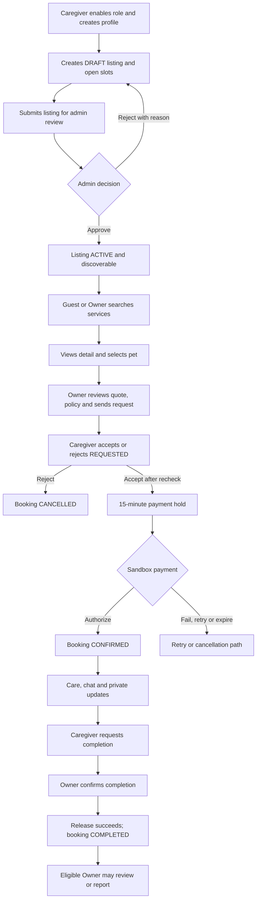
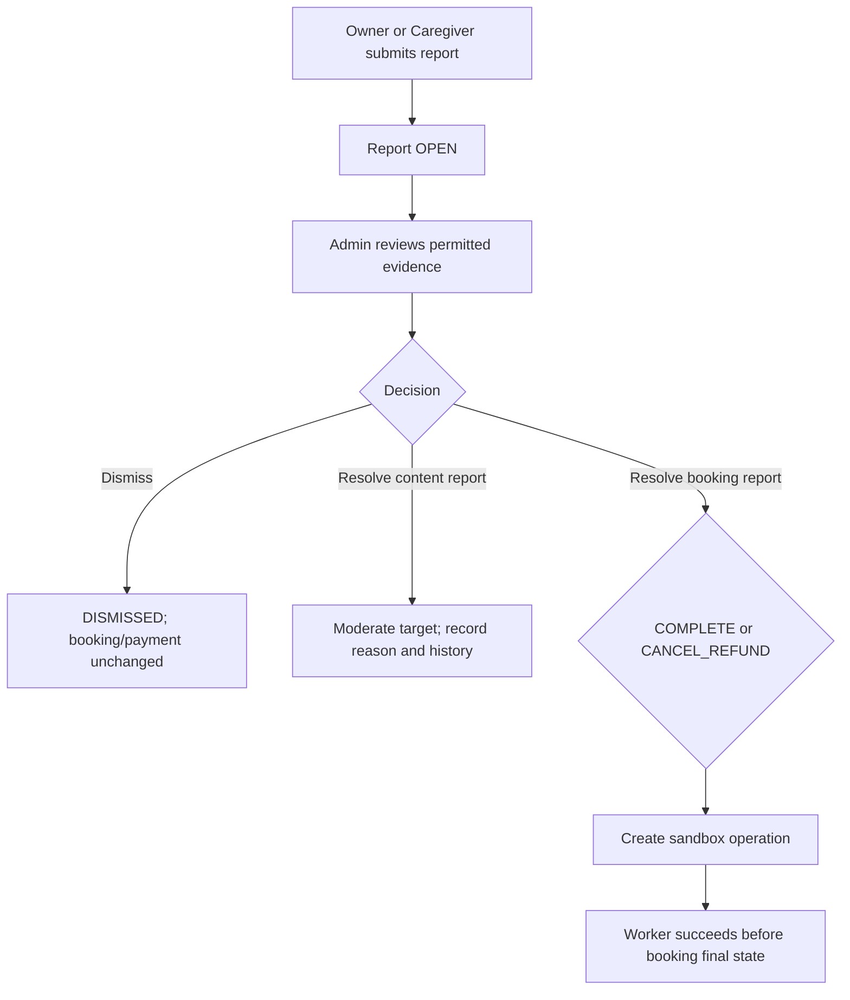

# 03 — Master Flow & Navigation Model

**Status:** Booking/listing/payment transitions are CONFIRMED by the P0 Contract. Navigation and prototype presentation are PROPOSED where no Vue UI exists.

## 1. Product master flow

## 2. Supporting admin flow

## 3. Role-specific journeys

### Guest to Owner

1. Guest enters public discovery; can search and open public ACTIVE listing detail.
2. To manage a pet, start a booking, message, review or report, sign in/register as Owner.
3. Owner creates/selects an ACTIVE pet, optionally runs Smart Match, and opens a listing detail.
4. Owner reviews a server-calculated quote, time range, cancellation policy and “sandbox / no real charge” label.
5. Owner sends an idempotent request; status is REQUESTED, not accepted or paid.
6. Owner sees caregiver response. If accepted, Owner uses sandbox success/failure/retry before the 15-minute deadline.
7. For CONFIRMED booking, Owner follows booking-specific chat/care updates, later confirms completion, and then may review.

### Caregiver

1. Signed-in user explicitly enables CAREGIVER, creates a profile and starts a DRAFT listing.
2. Caregiver enters service type, public area, unit price, acceptance rules, photos and continuous availability slots.
3. Caregiver submits for admin review. Rejected listing returns to DRAFT with a reason; critical edits use a change request.
4. On a REQUESTED booking, caregiver accepts only after server rechecks listing/profile/account, acceptance rules, slot coverage and overlap, or rejects with a reason-coded event.
5. After authorization, caregiver starts care, messages, posts updates only while IN_PROGRESS, then requests completion.

### Admin

1. Admin signs into the existing Filament panel and/or authorized admin workflow.
2. Listing review, report moderation, evidence access and booking exceptions are reasoned and audited.
3. Booking report decisions go through the report/booking operation service. UI must not imply immediate completion/refund while a sandbox operation is pending or failed.

**Boundary:** workspace includes a Filament Reports resource and admin API routes; listing moderation is in API routes but no Filament listing resource was found. User confirmed on 11/11/2026 that the prototype should include limited Filament-style references for listing moderation and reports, with no separate Admin SPA. Show booking-operation status within its relevant report case rather than as a new dashboard.

## 4. Navigation model (PROPOSED)

| Mode | Primary navigation | Context-specific destinations |
|---|---|---|
| Guest | Tìm dịch vụ, Đăng nhập, Đăng ký | Listing detail; filters and results |
| Owner | Khám phá, Thú cưng, Lịch đặt, Hồ sơ | Booking detail; checkout; conversation/care updates; reviews; reports |
| Caregiver | Tổng quan, Yêu cầu đặt, Dịch vụ, Lịch | Listing editor/review status; booking detail; conversation/care updates |
| Admin | Existing Filament navigation | Listing moderation reference; Reports queue/detail/history/evidence; booking completion/cancellation queues where supported |

Navigation should be role-aware but never function as an authorization control. A prototype persona selector is a demo affordance; it must not imply a user can self-assign ADMIN.

## 5. Cross-flow rules

- Public discovery exposes only the listing allowlist. Pet data, booking snapshots, private address and private media never appear there.
- Availability shown in search is indicative. Create/accept revalidates current state; overlapping REQUESTED requests may coexist, but only one may be accepted for a listing interval.
- Each booking has its own conversation; a repeat booking with the same caregiver does not merge old messages.
- Business status and visual state are separate: pending release may show “Đang xử lý” without displaying COMPLETED.
- Error feedback preserves safe form values. 401/419 re-authenticates/refreshes CSRF; 403/404 do not reveal private resources; 409 explains stale state/conflict; 422 points to the field.
- Every P0 action either causes a valid transition or is disabled with an explanation.

## 6. Feature flow index

| ID | Actor(s) | Journey |
|---|---|---|
| F01 | Guest, Owner | Account, role activation and pet management |
| F02 | Guest, Owner | Discovery and Smart Match |
| F03 | Caregiver, Admin | Listing, availability and moderation |
| F04 | Owner, Caregiver | Booking create/accept/reject/cancel |
| F05 | Owner, sandbox, Admin | Sandbox payment and operation handling |
| F06 | Caregiver, Owner, Admin | Care lifecycle and completion |
| F07 | Owner, Caregiver, Admin | Conversation, care updates and private media |
| F08 | Owner, Admin | Eligible reviews and visible ratings |
| F09 | Owner, Caregiver, Admin | Reports, evidence, moderation and booking decisions |

**Sources:** Product Overview/Scope; Actors & Roles; Workflows 01–04; P0 Contract §§1–13; current routes and Filament resources.
